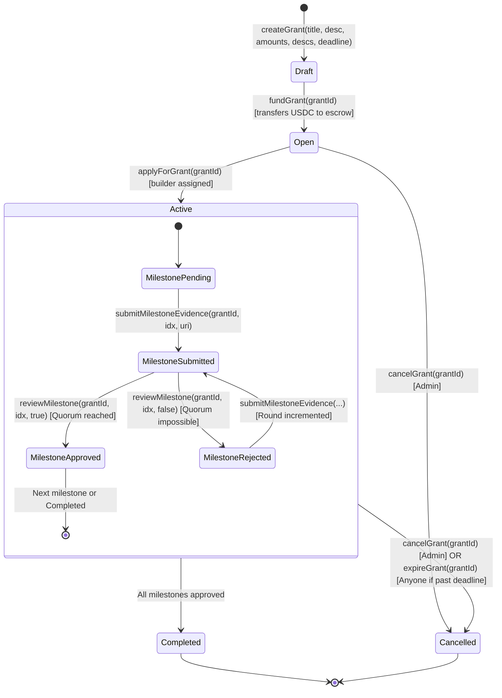
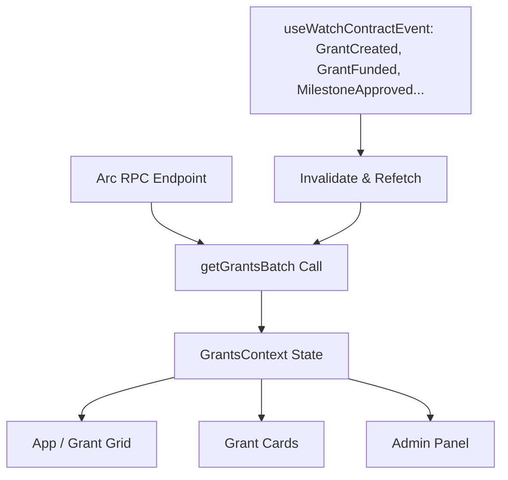
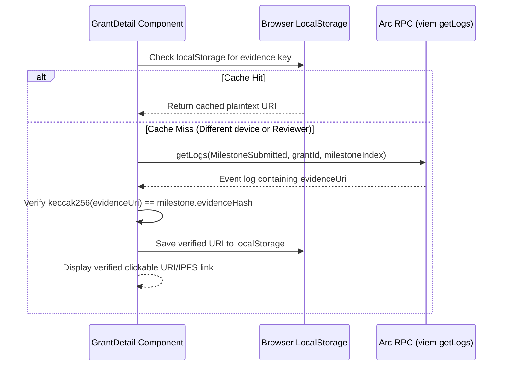

# GrantFlow — System Architecture & Technical Specification

> **Target Network:** Arc Mainnet (Chain ID `5042`)  
> **Contract Engine:** ProofSpring v2  
> **Status:** Approved for Implementation (Phase 3 UI Redesign)

---

## 1. System Overview

**GrantFlow** (contract identifier: `ProofSpring`) is a decentralized, milestone-gated microgrants platform engineered for the Arc blockchain ecosystem. It enables grant committees, DAOs, and funding bodies to create USDC-backed grants where funds are held safely in escrow and disbursed only upon cryptographic, onchain verification of work.

### Core Principles
1. **Zero-Trust Milestone Escrow:** Capital is locked in the smart contract and only queued for payout when designated reviewers vote to approve submitted evidence.
2. **Pull Payment Security:** GrantFlow never pushes USDC automatically. Instead, approved funds accumulate in `pendingWithdrawals` (for builders) or `pendingFunderRefunds` (for funders on cancellation/expiry), protecting the protocol against malicious recipient reverts and reentrancy vectors.
3. **Storage-Gas Efficiency with Event-Indexed Evidence:** Raw evidence strings (URLs, IPFS CIDs, and markdown reports) are emitted in `MilestoneSubmitted` events rather than stored in expensive contract storage. Only a `bytes32` hash (`keccak256(evidenceUri)`) is persisted in state.
4. **Deterministic Quorum & Anti-Deadlock:** Grant funding requires `reviewerCount >= requiredApprovals`. Strict voting math enables early auto-approval (when approval threshold is met) and early auto-rejection (when remaining reviewers cannot possibly reach quorum).

---

## 2. Chain & Environment Architecture

### 2.1 Target Networks

| Parameter | Arc Mainnet (Primary Target) | Arc Testnet (Development / Staging) |
|---|---|---|
| **Chain ID** | `5042` | `5042002` |
| **RPC Endpoint** | `https://rpc.arc.io` | `https://rpc.testnet.arc.io` |
| **Block Explorer** | `https://explorer.arc.io` | `https://explorer.testnet.arc.io` |
| **Canonical USDC** | `0x3600000000000000000000000000000000000000` | `0x3600000000000000000000000000000000000000` |
| **Currency Symbol** | `USDC` (6 decimals, native gas token) | `USDC` (6 decimals) |

> [!IMPORTANT]
> **Arc Native USDC Address:** On Arc, the native gas token and standard ERC-20 interface is accessible at `0x3600000000000000000000000000000000000000`. Deployments initialized with foreign addresses (such as BSC USDC `0x8AC...`) fail because no contract bytecode exists at those addresses on Arc.

### 2.2 Network Switching & Transport Configuration

The wagmi/viem client config is structured to prioritize Arc Mainnet while gracefully allowing testnet connectivity:
```typescript
import { createConfig, http } from 'wagmi'
import { injected } from 'wagmi/connectors'
import { defineChain } from 'viem'

export const arcMainnet = defineChain({
  id: 5042,
  name: 'Arc Mainnet',
  nativeCurrency: { name: 'USDC', symbol: 'USDC', decimals: 6 },
  rpcUrls: {
    default: { http: ['https://rpc.arc.io'] },
  },
  blockExplorers: {
    default: { name: 'Arc Explorer', url: 'https://explorer.arc.io' },
  },
})

export const arcTestnet = defineChain({
  id: 5042002,
  name: 'Arc Testnet',
  nativeCurrency: { name: 'USDC', symbol: 'USDC', decimals: 6 },
  rpcUrls: {
    default: { http: ['https://rpc.testnet.arc.io'] },
  },
  blockExplorers: {
    default: { name: 'Arc Testnet Explorer', url: 'https://explorer.testnet.arc.io' },
  },
})
```

---

## 3. Smart Contract Architecture (`ProofSpring.sol`)

### 3.1 Data Structures & Enums

```solidity
enum GrantStatus { Draft, Open, Active, Completed, Cancelled }
enum MilestoneStatus { Pending, SubmittedForReview, Approved, Rejected }

struct Milestone {
    string description;       // Stored in contract storage
    uint128 amount;           // 6 decimals USDC
    MilestoneStatus status;   // uint8
    bytes32 evidenceHash;     // keccak256(evidenceUri)
    uint32 round;             // Incremented on resubmission after rejection
}

struct Grant {
    string title;
    string description;
    address funder;
    address builder;
    uint128 totalAmount;
    uint128 releasedAmount;
    GrantStatus status;
    uint40 deadline;          // Unix timestamp; 0 = no deadline
    Milestone[] milestones;
}
```

### 3.2 State Machine & Workflow



### 3.3 Pull-Payment Engine

Funds are disbursed exclusively through two pull-payment functions:
1. `claimPayment()`:
   - Increments builder's available balance when a milestone is approved (`pendingWithdrawals[builder] += milestone.amount`).
   - Builder executes `claimPayment()` to transfer USDC to their wallet via OpenZeppelin `SafeERC20.safeTransfer`.
2. `claimFunderRefund()`:
   - When a grant is cancelled or expired, remaining unreleased USDC is queued: `pendingFunderRefunds[funder] += (totalAmount - releasedAmount)`.
   - Funder executes `claimFunderRefund()` to retrieve their capital.

---

## 4. Frontend Architecture & Data Layer

### 4.1 Global Context & Caching Strategy (`GrantsContext`)

To prevent RPC throttling and redundant network calls, GrantFlow implements a centralized reactive cache:



- **Batch Fetching:** For datasets ≤ 50 grants, `getGrantsBatch(0, count)` retrieves all grant data in a single RPC query.
- **Event-Driven Cache Invalidation:** `useWatchContractEvent` listens for:
  - `GrantCreated`, `GrantFunded`, `GrantApplied`
  - `MilestoneSubmitted`, `MilestoneReviewCast`, `MilestoneApproved`
  - `GrantCompleted`, `GrantCancelled`, `PaymentClaimed`
- **Zero-Flicker Navigation:** React Query caching (`gcTime: 10 * 60 * 1000`) preserves grant data in memory when switching between views.

### 4.2 Multi-Device Evidence Resolution Engine

Because the smart contract stores only `bytes32 evidenceHash` to minimize gas fees, plaintext evidence strings are resolved seamlessly across devices using a 2-tier strategy:



#### Evidence Resolver Implementation
```typescript
async function resolveMilestoneEvidence(
  publicClient: PublicClient,
  contractAddress: Address,
  grantId: bigint,
  milestoneIndex: number,
  expectedHash: `0x${string}`
): Promise<string | null> {
  // 1. Check local device cache
  const cached = readEvidenceFromCache(grantId, milestoneIndex)
  if (cached) return cached

  // 2. Query event logs from onchain receipt
  try {
    const logs = await publicClient.getLogs({
      address: contractAddress,
      event: parseAbiItem(
        'event MilestoneSubmitted(uint256 indexed grantId, uint256 indexed milestoneIndex, string evidenceUri, address indexed builder)'
      ),
      args: {
        grantId,
        milestoneIndex: BigInt(milestoneIndex),
      },
      fromBlock: 'earliest',
      toBlock: 'latest',
    })

    if (logs.length > 0) {
      // Pick the latest log for this milestone (matching current round)
      const latestLog = logs[logs.length - 1]
      const uri = latestLog.args.evidenceUri as string
      
      // Verify cryptographic integrity
      if (keccak256(toHex(uri)) === expectedHash) {
        saveEvidenceToCache(grantId, milestoneIndex, uri)
        return uri
      }
    }
  } catch (err) {
    console.error('Failed to fetch onchain evidence log:', err)
  }
  return null
}
```

---

## 5. UI/UX Design System & Component Hierarchy

### 5.1 Component Structure

```
src/
├── components/
│   ├── Header.tsx              # Brand identity, Network status, Wallet connect, Admin pill
│   ├── GrantCard.tsx           # Grid item: status, funding progress, milestone bar, deadline badge
│   ├── GrantDetail.tsx         # Comprehensive grant view, evidence timeline, review actions, claim cards
│   ├── AdminPanel.tsx          # Drawer/Modal: Create Grant, Fund Grants, Reviewer management, Expiration/Reassignment
│   ├── EvidenceViewer.tsx      # Modal / Popover: Full evidence inspect, IPFS gateway link, hash proof
│   ├── StatusBadge.tsx         # Standardized accessible status pill with icon + label
│   └── GrantSkeleton.tsx       # Content loader skeleton
├── context/
│   └── GrantsContext.tsx       # Global batch-fetched grants state & event subscriptions
├── hooks/
│   ├── useProofSpring.ts       # Typed viem/wagmi read & write hooks
│   └── useEvidenceResolver.ts  # Hook querying getLogs with caching
├── contracts/
│   └── proofSpring.ts          # Contract addresses, ABIs, chain constants
└── index.css                   # Custom theme tokens, typography, button variants
```

### 5.2 Responsive Layout & Touch Targets

- **Mobile Viewport (`< 640px`):**
  - Single-column stack.
  - Interactive elements (buttons, inputs, tabs) enforce a **minimum touch target of 44px × 44px**.
  - Horizontal scrolling tab bars with subtle gradient fade indicators.
  - Full-width action sheets for milestone review and evidence submission.
- **Tablet / Small Desktop (`640px – 1024px`):**
  - 2-column card grid (`gap-6`).
  - Slide-over drawer for Admin Panel.
- **Desktop (`> 1024px`):**
  - 3-column card grid (`max-w-7xl mx-auto`).
  - Split-view in `GrantDetail` with sticky sidebar for grant financial overview and payout claims.

### 5.3 Color System & Design Tokens

```css
:root {
  --spring: #10b981;          /* Emerald 500 — Positive actions, approvals, USDC balance */
  --spring-glow: rgba(16, 185, 129, 0.15);
  --accent: #6366f1;          /* Indigo 500 — Primary brand links, progress fills */
  --accent-glow: rgba(99, 102, 241, 0.15);
  --danger: #ef4444;          /* Red 500 — Rejections, cancellation, expiry warning */
  --ink: #0f172a;             /* Slate 900 — Deep typography */
  --muted: #64748b;           /* Slate 500 — Secondary descriptions */
  --subtle: #94a3b8;          /* Slate 400 — Borders, dividers, timestamps */
  --surface: #ffffff;         /* Pure white background for cards */
  --surface-muted: #f8fafc;   /* Slate 50 — Off-white backgrounds */
  --surface-strong: #f1f5f9;  /* Slate 100 — Elevated component fills */
}
```

### 5.4 New Functional Capabilities in UI

1. **Deadline Datepicker & Expiry Indicators:**
   - Creation form supports an optional deadline (UTC datetime picker).
   - Grant cards display a countdown badge:
     - 🟢 `X days left`
     - 🟡 `< 24 hours left` (urgent warning)
     - 🔴 `Expired` (past deadline, unlocks `expireGrant`)
2. **Builder Reassignment UI:**
   - In Admin Panel: "Stalled Grants" tab allows the admin to invoke `adminReassignBuilder(grantId, newBuilderAddress)` if an assigned builder becomes unresponsive.
3. **Stale Grant Expiration Action:**
   - For grants past deadline with unapproved milestones, any participant can trigger `expireGrant(grantId)`, automatically returning remaining escrowed USDC to the funder's claimable refund balance.
4. **Accessible Inline Confirmations:**
   - Zero usage of browser-native `window.confirm()`. All destructive actions (Cancel Grant, Reject Milestone, Expire Grant) utilize embedded inline confirmation trays with clear "Yes, proceed" and "Cancel" buttons.

---

## 6. Security, Compliance & DoraHacks Hackathon Checklist

### 6.1 DoraHacks Hackathon Compliance
- [x] Canonical Arc native USDC address (`0x3600000000000000000000000000000000000000`).
- [ ] Contract deployed on **Arc Mainnet** (Chain ID `5042`).
- [ ] Real USDC funded and transferred on Mainnet with verifiable transaction hash on `explorer.arc.io`.
- [ ] Arc Studio workspace link configured.
- [ ] Deployed web application URL with responsive UX.

### 6.2 Smart Contract Security & Guards
- **SafeERC20:** All token interactions use OpenZeppelin SafeERC20.
- **ReentrancyGuard:** `claimPayment` and `claimFunderRefund` are protected with `nonReentrant`.
- **Pull over Push:** All payouts require explicit recipient claims; no transfers happen inside loop iterations or state-transition functions.
- **Role Isolation:** Admins cannot apply as builders; reviewers cannot apply as builders; only assigned builders can submit milestone proofs.

---

## 7. Verification & Testing Matrix

- **Unit Tests (`forge test`):** 23/23 tests covering happy path, cancellations, deadline expiration, builder reassignment, and boundary checks.
- **Type Safety (`tsc --noEmit`):** Full TypeScript inference between wagmi hooks and Foundry contract artifacts.
- **Event Query Verification:** Automated test verifies `getLogs` returns expected evidence URI string matching onchain `evidenceHash`.
